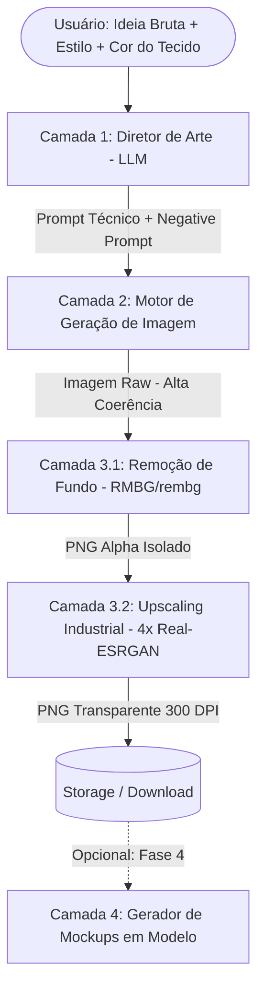

# Arquitetura Técnica — Cristopher AI

Documentação dos componentes técnicos, fluxos de dados, motores de geração e requisitos industriais para impressão têxtil.

---

## 1. Visão Geral do Fluxo de Dados



---

## 2. Detalhamento dos Componentes

### Camada 1: Diretor de Arte (Expansão de Prompt)
* **Objetivo:** Traduzir linguagem natural leiga em parâmetros gráficos avançados de estamparia.
* **Modelo Sugerido:** LLM rápido e econômico (`gpt-4o-mini`, `gemini-1.5-flash` ou `claude-3-5-haiku`).
* **Regras de Negócio:**
  * Forçar sempre fundo sólido monocromático de alto contraste com a estampa (facilita o recorte da Camada 3).
  * Injetar palavras-chave do estilo selecionado (ex: `halftone dots`, `vintage screenprint`, `vector linework`).
  * Adicionar restrições de isolamento estrito (evitar geração de camisetas completas, manequins ou dobras de pano).

### Camada 2: Motor de Geração de Imagem

| Motor | Especialidade na Christopher | Custo Médio | Veredito |
| :--- | :--- | :--- | :--- |
| **Recraft V3** (via Fal.ai / API) | **Gera Vetor Real (SVG)** e Stencil P&B. Ideal para o Pilar 3 (*Woodcut/Stencil*) e logos sem perda de resolução. | ~$0.04 (Raster) / $0.08 (SVG) | **Recomendado para Stencil e Vetor** |
| **Ideogram v2 / v2a** | **Rei da Tipografia e Textos Arqueados.** Ideal para Pilares 1 e 2 (*JESUS HAS MY BACK*, versículos). | ~$0.04 a $0.08 | **Recomendado para Estampas Tipográficas** |
| **Flux.1 [Schnell]** (via Fal.ai) | **Modo Rascunho Ultra Barato.** Geração em < 1.5s para teste de composição antes do fechamento. | ~$0.003 (~R$ 0,02) | **Recomendado para Brainstorming Rápido** |
| **Flux.1 [Dev]** (via Fal.ai) | Texturas renascentistas ricas e detalhes para o Pilar 4 (*Halftone Sacro*). | ~$0.025 a $0.04 | **Recomendado para Halftone e Pinturas** |
| **Midjourney v6** | Estética artística crua. | Assinatura fixa mensal / **Sem API oficial** (risco de ban via bot). | Usar apenas via navegador para testes manuais |

### Camada 3: Pós-Processamento Industrial

Para que uma estampa possa ir para a máquina de DTF (Direct to Film) ou DTG (Direct to Garment), ela precisa atender a critérios técnicos estritos:

1. **Remoção de Fundo & Knockout de Cor (Custo Zero):**
   * **Método 1 — Color/Luminance Knockout (Python Puro com Pillow / NumPy):**
     * Como as artes da Christopher são monocromáticas sobre fundo plano (preto puro para camisetas escuras ou branco puro para camisetas claras), o canal alpha é extraído diretamente da luminância dos pixels:
       $$\text{Alpha} = \text{Luminância}(R, G, B)$$
     * **Resultado:** Custo $0.00, execução instantânea (< 10ms), zero halos cinzas e preservação exata de linhas de 1 pixel.
   * **Método 2 — Modelos Neurais (`bria-rmbg-2.0` / `rembg`):**
     * Reservado apenas para artes fotográficas ou rascunhos com fundos complexos importados externamente do ChatGPT.
2. **Upscaling & Resolução (DPI):**
   * Se a arte for gerada via **Recraft V3**, o arquivo já é entregue em **Vetor SVG nativo** (resolução infinita sem necessidade de upscaler).
   * Para imagens raster (Ideogram/Flux/ChatGPT): Real-ESRGAN local para atingir 4096x4096px com 300 DPI sRGB.

---

## 3. Contratos de Dados (I/O)

### Payload de Entrada do Usuário
```json
{
  "concept": "astronauta tocando guitarra em cima de uma pizza cósmica",
  "style_preset": "vintage_washed_90s",
  "target_shirt_color": "black",
  "has_text": true,
  "text_content": "ASTRO SLICE"
}
```

### Saída da Camada 1 (Prompt Expandido para a API de Imagem)
```json
{
  "prompt": "Vintage washed 90s screen print illustration of an astronaut playing an electric guitar standing on a floating slice of cosmic pizza, text 'ASTRO SLICE' in retro bold distressed typography, vibrant muted retro colors, halftone pattern, distressed vintage texture, bold outlines, isolated on pure white solid background",
  "negative_prompt": "photorealistic t-shirt mockup, fabric folds, wrinkles, human model wearing shirt, hanger, shadows on background, blurry edges, gradient background, frame, border, cropped",
  "aspect_ratio": "1:1",
  "engine": "ideogram-v2"
}
```

### Saída da Camada 3 (Arquivo Pronto para Produção)
```json
{
  "status": "ready",
  "file_url": "https://.../exports/print_astro_slice_300dpi.png",
  "metadata": {
    "dimensions": "4096x4096",
    "dpi": 300,
    "format": "PNG",
    "has_transparency": true,
    "file_size_mb": 8.4
  }
}
```
